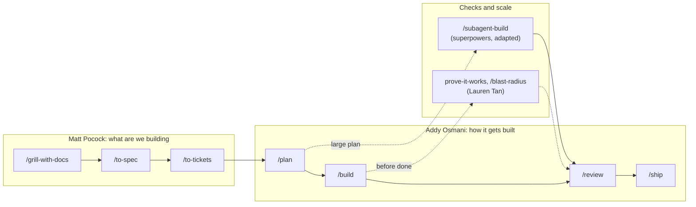
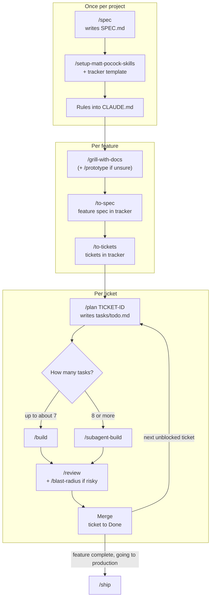
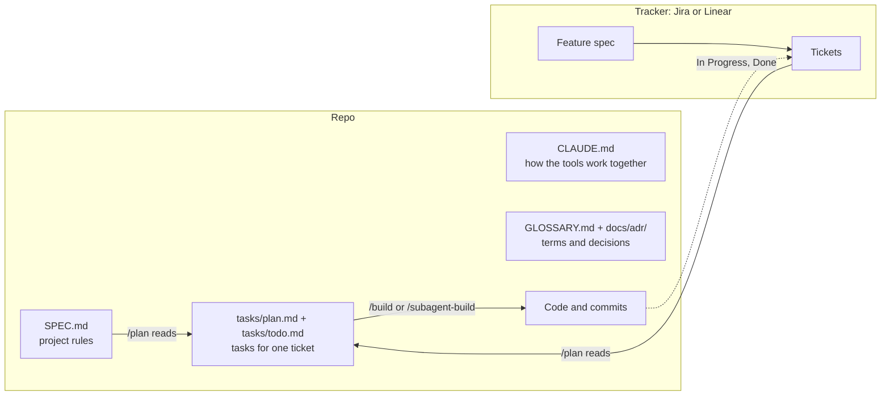

# agent-harness

A small, curated set of agent skills for Claude Code that runs on top of [Addy Osmani's agent-skills](https://github.com/addyosmani/agent-skills).

Addy's pack covers the full development lifecycle: spec, plan, build, test, review, ship. This repo adds what it leaves out: sharpening requirements before anything is written, turning them into tickets in Jira or Linear, proving the work actually runs, and building large plans with a fresh subagent per task.

Installing every skill pack at once gives you well over a hundred skills, many of them overlapping. This repo takes the few that fill real gaps and leaves the rest.

**Contents:** [Credits](#credits) · [Install](#install) · [How it fits together](#how-it-fits-together) · [Project setup](#project-setup) · [The workflow](#the-workflow) · [Two kinds of spec](#two-kinds-of-spec) · [Where everything lives](#where-everything-lives) · [Which skill when](#which-skill-when) · [Ceremony matches the stakes](#ceremony-matches-the-stakes) · [What this repo adds](#what-this-repo-adds) · [What Addy's pack gives you](#what-addys-pack-gives-you) · [Updates](#updates)

## Credits

None of the skills here are mine. They are copied from their authors, unchanged except where noted, under the MIT license:

| Author | Repo | Skills taken |
|---|---|---|
| Matt Pocock | [mattpocock/skills](https://github.com/mattpocock/skills) | grill-me, grilling, grill-with-docs, domain-modeling, to-spec, to-tickets, prototype, handoff, writing-for-agents, setup-matt-pocock-skills |
| Lauren Tan | [pstack](https://github.com/cursor/plugins/tree/main/pstack) | principle-prove-it-works, blast-radius, create-verification-skill, reflect, unslop |
| Jesse Vincent | [superpowers](https://github.com/obra/superpowers) | using-git-worktrees, and subagent-driven-development, adapted as subagent-build |
| Addy Osmani | [agent-skills](https://github.com/addyosmani/agent-skills) | Not copied. Install it separately. |

Exact sources and commits are in [SOURCES.md](SOURCES.md). Licenses are in [licenses/](licenses/).

## Install

Install Addy's pack first, then this one. `agent-harness` builds on it: `subagent-build` hands off to Addy's `/review` and `/ship`.

In Claude Code, run these one at a time:

```
/plugin marketplace add addyosmani/agent-skills
/plugin install agent-skills@addy-agent-skills
/plugin marketplace add ivansolic/agent-harness
/plugin install agent-harness@agent-harness
```

When asked where to install, choose one:

- **User scope**: for you, in every project. The usual choice.
- **Project scope**: written to the project's settings, so everyone who opens the project in Claude Code is offered the same plugins. Use this to give a team the same setup.

Then:

1. Open `/plugin`, go to Marketplaces, and turn on auto-update for both `addy-agent-skills` and `agent-harness`. Updates are picked up when Claude Code starts.
2. Restart Claude Code.
3. Type `/` and check that `grill-with-docs` and `spec` are listed. Plugin skills may show with a prefix, such as `/agent-harness:grill-with-docs`.

### Troubleshooting

**`Host key verification failed` when installing.** Claude Code clones plugins over SSH, and SSH to GitHub isn't set up on this machine. Tell git to use HTTPS for GitHub instead:

```
git config --global url."https://github.com/".insteadOf "git@github.com:"
```

Then run the install again.

## How it fits together

Each source covers a different part of the work. Addy's pack is the spine; the others plug in before and around it.



| Source | Its job here |
|---|---|
| Matt Pocock | Clarify the idea, write the feature spec, cut tickets in Jira or Linear |
| Addy Osmani | Project spec, plan, test-first build, review, launch checklist |
| Lauren Tan (pstack) | Prove it works on the real thing; find what a change can break |
| Jesse Vincent (superpowers) | Build a large plan with a fresh subagent and a review per task |

## Project setup

Once per project, in this order:

1. **Write the project spec.** Run Addy's `/spec`. It asks about the project and writes `SPEC.md` at the repo root: objective, tech stack, commands, project structure, code style, testing strategy, and boundaries (what the agent always does, asks first about, and never does). On an existing codebase it describes what is already there. `/plan`, `/build auto` and `/subagent-build` read this file, and `/build auto` and `/subagent-build` stop if it is missing.
2. **Set the quality bar (optional).** Run Addy's `/constraints`. It writes `CONSTRAINTS.md` with thresholds for coverage, performance or accessibility, and suggests sane defaults if you have no numbers in mind.
3. **Set up the tracker.** Run `/setup-matt-pocock-skills` and choose "Other" for the issue tracker.
4. **Point it at Jira or Linear.** Copy a tracker template into the project as `docs/agents/issue-tracker.md` and fill in the workspace details:
   - Jira: `templates/issue-tracker-jira.md`
   - Linear: `templates/issue-tracker-linear.md`
5. **Connect that tracker** to Claude Code.
6. **Add the project rules to `CLAUDE.md`.** Claude Code reads the project's `CLAUDE.md` at the start of every session, so these rules always apply:

   ```
   cat ~/code/agent-harness/templates/CLAUDE-specs.md >> CLAUDE.md
   ```

   Adjust the path to wherever you cloned this repo, or copy [the file](templates/CLAUDE-specs.md) from GitHub. The rules:
   - keep `SPEC.md` for project-wide rules and feature details in the tracker
   - make the agent stop and ask when a ticket conflicts with `SPEC.md`
   - require specific, measurable acceptance criteria
   - keep tasks in `tasks/todo.md`, where `/subagent-build` reads them
   - move tickets to In Progress and Done as work starts and finishes
7. **Commit** `SPEC.md`, `CLAUDE.md` and `docs/`, so everyone on the project works from the same setup.

## The workflow

Work happens at three levels: once per project, once per feature, and once per ticket.



### Per feature

1. **`/grill-with-docs`.** Describe the idea in a few sentences. The agent asks one question at a time until it is clear, and records terms in `GLOSSARY.md` and decisions in `docs/adr/`. If you're unsure whether an approach can work at all, run `/prototype` here.
2. **`/to-spec`.** Turns that conversation into a feature spec (problem, solution, user stories, decisions) and publishes it to the tracker.
3. **`/to-tickets`.** Splits the spec into tickets with acceptance criteria and dependencies. The tracker board now shows what to do and in what order.

### Per ticket

Take a ticket that isn't blocked.

1. **`/plan TICKET-ID`.** Addy's planner reads the ticket through the connected tracker and the rules in `SPEC.md`, and writes small tasks with checkpoints to `tasks/todo.md`. Review and approve.
2. **Build.**
   - Up to about seven tasks: `/build` for one task at a time, or `/build auto` for the whole plan after one approval.
   - Eight or more: `/subagent-build`, which stops at each checkpoint and waits for you.
3. **`/review`.** Five-axis review of the change. If the change is risky or touches something many parts depend on, add `/blast-radius`.
4. **Merge.** The ticket moves to Done, and the tickets it blocked open up.

When every ticket of a feature is done and it is going to production, run **`/ship`** for a go or no-go.

### Along the way

- Stopping halfway: `/handoff`, so the next session knows where you left off.
- The agent got something wrong: `/reflect`, then fix the skill it should have followed.
- A small tweak: no skills. Ask for the change and look at the result.

## Two kinds of spec

Addy's `/spec` and Matt's `/to-spec` don't compete. One is the house rules, the other describes one job done in that house. `/plan` reads both: the ticket for what to build, `SPEC.md` for how.

| | Addy's `/spec` | Matt's `/to-spec` |
|---|---|---|
| Answers | How things are built in this project | What we're building and why |
| For | The agent and developers | PMs, the team and the agent |
| How often | Once per project, updated when a project-wide rule changes | Once per feature |
| Lives in | `SPEC.md` in the repo | Jira or Linear |
| Sections | Objective, Tech Stack, Commands, Project Structure, Code Style, Testing Strategy, Boundaries, Success Criteria, Open Questions | Problem Statement, Solution, User Stories, Implementation Decisions, Testing Decisions, Out of Scope, Further Notes |
| Key part | Boundaries: what the agent always does, asks first about, never does | User stories: "As a X, I want Y, so that Z" |
| Made by | Asking about the project | Summing up the `/grill-with-docs` conversation, no new questions |

Addy's spec skill supports this split: when a project already uses another spec system, it keeps that system instead of duplicating it into `SPEC.md`. The rules in `templates/CLAUDE-specs.md` keep the two apart in practice.

## Where everything lives



| What | Written by | Where |
|---|---|---|
| Project spec: stack, commands, boundaries | Addy's `/spec` | `SPEC.md` |
| Quality bar | Addy's `/constraints` | `CONSTRAINTS.md` |
| Rules for how the tools work together | You, from `templates/CLAUDE-specs.md` | `CLAUDE.md` |
| Glossary and decision records | `/grill-with-docs` | `GLOSSARY.md`, `docs/adr/` |
| Feature spec: problem, user stories, decisions | `/to-spec` | The tracker |
| Tickets with acceptance criteria | `/to-tickets` | The tracker |
| Tasks for one ticket | Addy's `/plan` | `tasks/plan.md`, `tasks/todo.md` |

The tracker shows the work at ticket level: what's open, what's blocked, what's next. Tasks are a developer-level detail that opens and closes inside one ticket, so they stay in the repo.

## Which skill when

| Situation | Use |
|---|---|
| A fuzzy idea, or you're not sure what you want | `/grill-me` (no docs) or `/grill-with-docs` (records terms and decisions) |
| Work that goes into Jira or Linear | `/grill-with-docs` → `/to-spec` → `/to-tickets` |
| Work that doesn't go into a tracker | `/grill-with-docs`, then Addy's `/plan` → `/build` |
| You need to know if an approach works before committing to it | `/prototype`, a throwaway that answers one question |
| A UI or anything visual: screens, layout, flows | `/prototype` for a quick throwaway UI to react to; Addy's `frontend-ui-engineering` for the real build; Addy's `browser-testing-with-devtools` or `/create-verification-skill` to check it in a real browser |
| No quality bar written down yet | Addy's `/constraints` |
| A bug | Addy's `debugging-and-error-recovery`, then `/test` to pin it with a failing test |
| Code works but nobody wants to touch it | Addy's `/code-simplify` |
| Changing something many parts depend on | `/blast-radius` before you start, Addy's `doubt-driven-development` for the risky decisions |
| Web performance | Addy's `/webperf` |
| Ending a session halfway, or handing work to another agent | `/handoff` |
| The agent keeps making the same mistake | `/reflect`, then fix the skill it should have followed |
| Text reads like AI wrote it | `/unslop` |
| Writing your own skill or `CLAUDE.md` | `/writing-for-agents` |

## Ceremony matches the stakes

Don't run the whole workflow for everything.

| Work | Steps |
|---|---|
| Small tweak | No skills. Make the change and look at it. |
| Small feature | `/grill-with-docs`, then `/plan` and `/build` |
| Large or fuzzy feature | `/grill-with-docs` → `/to-spec` → `/to-tickets` → per ticket `/plan`, `/build`, `/review` |
| Production, security, anything irreversible | All of the above, plus `doubt-driven-development`, `/blast-radius` and `/ship` |

## What this repo adds

| Skill | Author | What it does |
|---|---|---|
| `grill-me`, `grilling` | Matt Pocock | Interviews you until a plan or idea is sharp |
| `grill-with-docs`, `domain-modeling` | Matt Pocock | The same interview, recording a glossary and decision records as it goes |
| `to-spec` | Matt Pocock | Turns the conversation into a spec and publishes it to your tracker |
| `to-tickets` | Matt Pocock | Splits a spec into tickets with dependencies |
| `prototype` | Matt Pocock | A throwaway prototype that answers one question |
| `handoff` | Matt Pocock | Summarizes a session for another agent or a fresh session |
| `writing-for-agents` | Matt Pocock | Rules for writing your own skills and CLAUDE.md files |
| `setup-matt-pocock-skills` | Matt Pocock | One-time setup per project (tracker, docs) |
| `principle-prove-it-works` | Lauren Tan | Checks the real artifact before calling anything done |
| `blast-radius` | Lauren Tan | Finds what a change can break outside its diff |
| `create-verification-skill` | Lauren Tan | Generates a skill that drives your app like a user |
| `reflect` | Lauren Tan | Turns a session's mistakes into skill updates |
| `unslop` | Lauren Tan | Removes AI phrasing from text |
| `using-git-worktrees` | Jesse Vincent | An isolated workspace; used by `subagent-build` |
| `subagent-build` | Jesse Vincent, adapted | Builds a large plan with a fresh subagent and a review per task |

## What Addy's pack gives you

Installed separately, from [addyosmani/agent-skills](https://github.com/addyosmani/agent-skills).

| Command | What it does |
|---|---|
| `/spec` | A structured spec before any code |
| `/plan` | Small, verifiable tasks with acceptance criteria and checkpoints |
| `/build` | Implements the next task test-first and commits it. `/build auto` runs the whole plan after one approval |
| `/test` | Test-driven workflow; for bugs, a failing test that proves the bug first |
| `/review` | Five-axis review: correctness, readability, architecture, security, performance |
| `/code-simplify` | Simpler code, same behaviour |
| `/constraints` | Writes the project's quality bar to `CONSTRAINTS.md` and holds the agent to it |
| `/webperf` | Web performance audit |
| `/ship` | Pre-launch checklist with a go or no-go decision |

It also has 25 skills that trigger on their own (debugging, API design, frontend UI, security, CI/CD, migrations, `doubt-driven-development` and more) and four reviewer agents: code reviewer, test engineer, security auditor and web performance auditor. See its README for the full list.

## subagent-build

Use it instead of `/build auto` for a plan with eight or more independent tasks. Each task gets a fresh subagent and its own review, so quality holds to the end of a long plan. It stops at every checkpoint in the plan and waits for you; `/subagent-build auto` runs through. It uses more tokens than `/build auto`.

`subagent-build` is superpowers' `subagent-driven-development`, adapted to read the files Addy's `/spec` and `/plan` produce. The task loop, prompts, fix loop, ledger and model selection are unchanged. It also stops at checkpoints by default, where the original never stops. Every change is listed in [patches/subagent-build-CHANGES.md](patches/subagent-build-CHANGES.md).

## Updates

The skills here are copies, so they don't update on their own. A GitHub Action (`Sync upstream skills`) runs every Monday, pulls the latest version of each skill from its source repo, and opens a pull request if anything changed. Review the diff before merging: these are instructions your agent will follow.

To run the same sync by hand: `bash scripts/sync.sh`.

`subagent-build` is rebuilt from the latest superpowers version with `patches/subagent-build.patch` applied. If superpowers changes the lines the patch touches, the sync warns and leaves `subagent-build` at its previous version until the patch is updated.

## Using this as a template

Fork it, then change the skill lists in `scripts/sync.sh` to the skills you want. Add your own skills under `skills/`; the sync only touches the directories it copies.

## License

MIT for everything written for this repo (see [LICENSE](LICENSE)). Each copied skill stays under its author's MIT license (see [licenses/](licenses/)).
